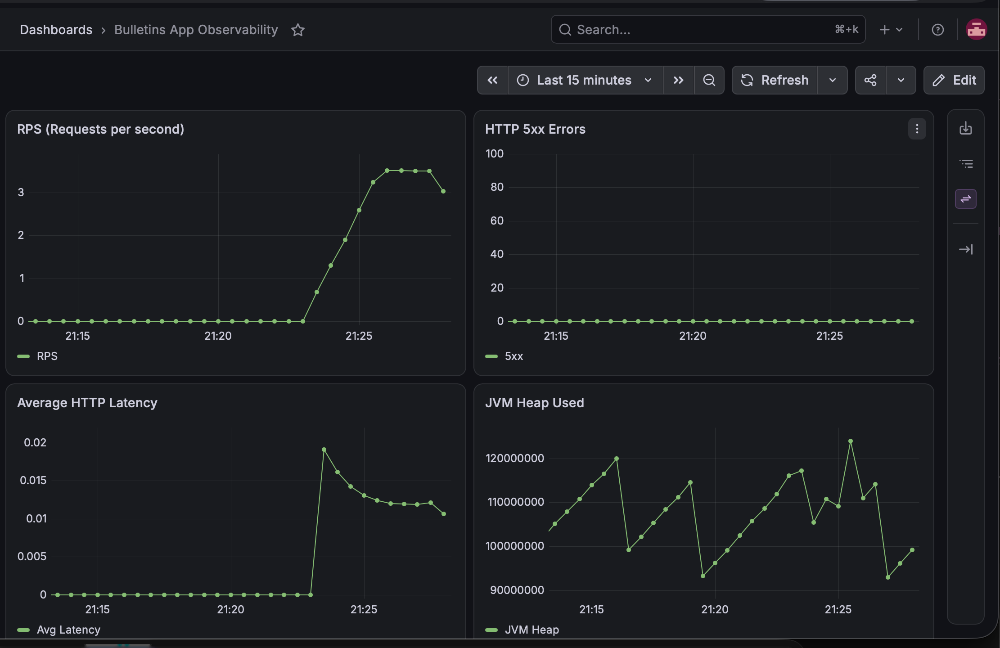
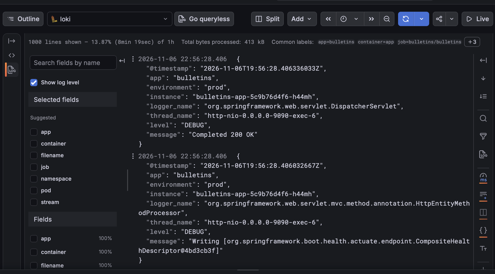
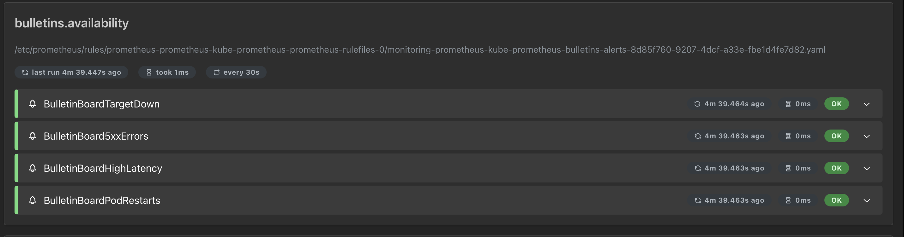
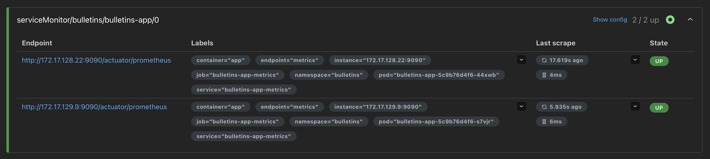
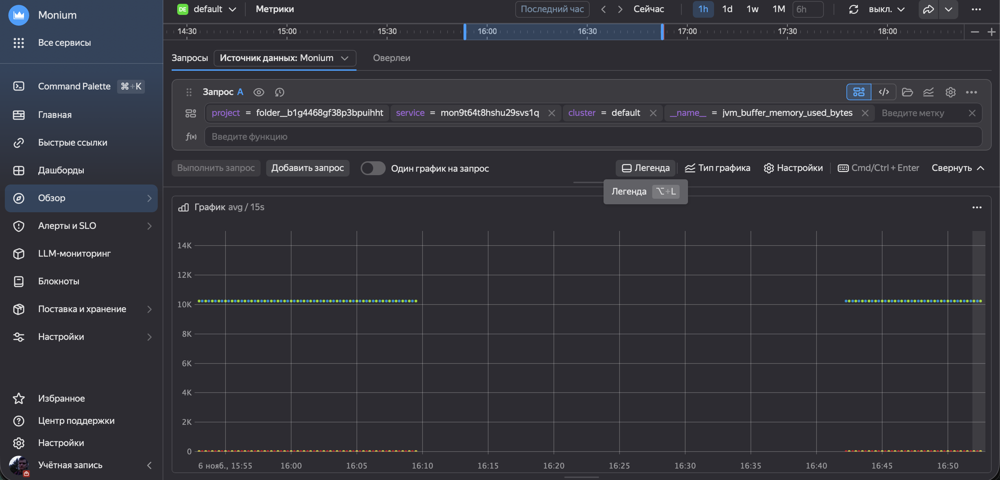
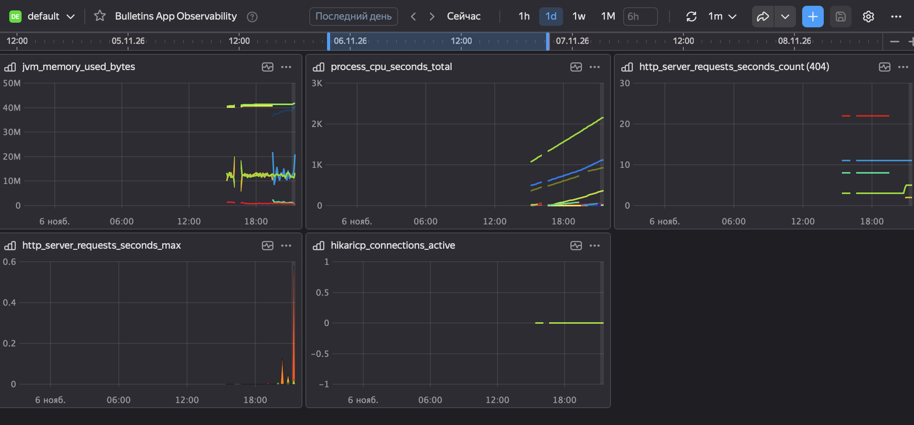

# Доска объявлений (Kubernetes)

[](https://github.com/otfantik/devops-engineer-from-scratch-project-319/actions)

Учебный проект Хекслета по курсу **DevOps-инженер с нуля**.

Приложение развернуто в **Yandex Cloud** (Managed Kubernetes) и полностью описано кодом (Terraform + Helm).

**Задеплоенное приложение:** [http://62.84.112.60](http://62.84.112.60)

## Что внутри

- **Приложение:** Spring Boot (Java) + React Admin (фронтенд).
- **Инфраструктура:** Terraform (VPC, Managed Kubernetes, Managed PostgreSQL, Object Storage, Lockbox, IAM).
- **Деплой:** Helm-чарт приложения.
- **Мониторинг:** Prometheus Operator + Yandex Managed Service for Prometheus (Monium).
- **Логи:** Grafana Loki.
- **Секреты:** Yandex Lockbox + External Secrets Operator (ESO).
- **CI/CD:** GitHub Actions (автотесты Hexlet).

## Стек

- Yandex Cloud (VPC, Managed Kubernetes, Managed PostgreSQL, Object Storage, Lockbox, IAM, Monitoring)
- Terraform
- Helm
- Kubernetes
- Docker
- Prometheus / Grafana / Loki
- External Secrets Operator
- Spring Boot (Java 25)
- React / Vite

## Требования

- Terraform `1.5+`
- Yandex Cloud CLI (`yc`)
- `kubectl`
- Helm `3.8+`
- `docker`
- `make`, `curl`, `jq`

## Структура репозитория

```text
.
├── .github/workflows/       # CI/CD и автотесты
├── assets/                  # Скриншоты для README
├── helm/                    # Values для kube-prometheus-stack
├── k8s/
│   ├── bulletin-board/      # Helm-чарт приложения
│   ├── eso/                 # SecretStore и ExternalSecret
│   ├── 07-monitoring.yml    # ServiceMonitor для Prometheus
│   ├── 08-grafana-dashboard.yml # Dashboard-as-Code
│   ├── 09-otel-logs.yml     # Конфиг OTel Collector для логов
│   ├── 10-otel-logs-daemonset.yml
│   └── 11-loki-datasource.yml
├── terraform/               # Инфраструктура (VPC, K8s, PG, S3, Lockbox, IAM)
├── Makefile
└── README.md

```

# Установка

## 1. Клонирование

bash    
git clone https://github.com/otfantik/devops-engineer-from-scratch-project-319.git
cd devops-engineer-from-scratch-project-319
## 2. Настройка Yandex Cloud

export YC_TOKEN="$(yc iam create-token)"
export YC_CLOUD_ID="$(yc config get cloud-id)"
export YC_FOLDER_ID="$(yc config get folder-id)"
## 3. Инфраструктура (Terraform)

### Создайте terraform/terraform.tfvars (не коммитится):
```
hcl
cloud_id    = "b1g5hcbk2va3o8rk278c"
folder_id   = "b1g4468gf38p3bpuihht"
pg_password = "ваш_пароль"
```
Примените:
```
cd terraform
terraform init
terraform apply
cd ..
```
## 4. Kubernetes (kubeconfig)

```
yc managed-kubernetes cluster get-credentials --id catmt905qa7t5jncikpr --external
```
## 5. Секреты (Lockbox + ESO)
# Ключ SA для ESO
```
yc iam key create --service-account-name external-secrets-sa --output sa-key.json
```
# Установка ESO (Yandex Marketplace)
```
helm pull oci://cr.yandex/yc-marketplace/yandex-cloud/external-secrets/charts/external-secrets \
  --version 2.5.0-2 --untar
helm install external-secrets ./external-secrets \
  --namespace external-secrets --create-namespace \
  --set-file auth.json=sa-key.json
```
# Создаем SecretStore и ExternalSecret
```
kubectl apply -f k8s/eso/
```
#### Важно: sa-key.json и values-secret.yaml не должны попадать в Git (они в .gitignore).
## 6. Деплой приложения (Helm)

```
helm upgrade --install bulletins-app k8s/bulletin-board -n bulletins
```
## 7. Мониторинг и логи
# kube-prometheus-stack
```
helm repo add prometheus-community https://prometheus-community.github.io/helm-charts
helm repo update
helm upgrade --install prometheus prometheus-community/kube-prometheus-stack \
  --namespace monitoring --create-namespace \
  -f helm/values-prometheus.yml

# ServiceMonitor и Dashboard
kubectl apply -f k8s/07-monitoring.yml
kubectl apply -f k8s/08-grafana-dashboard.yml

# Loki и OTel Collector для логов
kubectl apply -f k8s/09-otel-logs.yml
kubectl apply -f k8s/10-otel-logs-daemonset.yml
kubectl apply -f k8s/11-loki-datasource.yml
```
# Использование

## Проверка приложения

```
curl http://62.84.112.60/api/bulletins
```
## Мониторинг

### Grafana: 
```
kubectl -n monitoring port-forward svc/prometheus-grafana 3000:80
```
логин admin, пароль: ```
kubectl -n monitoring get secret prometheus-grafana -o jsonpath="{.data.admin-password}" | base64 -d```

### Дашборд: Bulletins App Observability (6 панелей: RPS, 5xx, Latency, JVM Heap, CPU, Restarts).
### Алерты: 
http://localhost:9090/rules (Prometheus).

#### Скриншоты:






## Логи

Grafana → Explore → Loki → {namespace="bulletins"}

## Секреты

### Секреты хранятся в **Yandex Lockbox**. ID секрета можно узнать после применения Terraform:

```
cd terraform
terraform output lockbox_secret_id
```
## Ротация:

Измените значение в Lockbox (через консоль или yc lockbox secret update).
ESO автоматически обновит Secret (в течение 1 минуты).
Перезапустите поды: kubectl -n bulletins rollout restart deployment bulletins-app.
## Makefile

```
make help           # Список команд
make tf-init        # Terraform init
make tf-plan        # Terraform plan
make tf-apply       # Terraform apply
make app-deploy     # Helm upgrade --install
make app-rollback   # Helm rollback
make monitoring-deploy # Установка kube-prometheus-stack
```
### CI/CD

hexlet-check.yml — автотесты Hexlet (запускаются на каждый коммит).
Секреты (SA-ключи, пароли) не хранятся в Git.
## <details> <summary>Автоматические тесты Хекслета</summary>
Тесты запускаются на каждый коммит. За запуск отвечает файл .github/workflows/hexlet-check.yml — не удаляйте и не переименовывайте ни его, ни репозиторий.

</details>
О Хекслете

Хекслет — школа программирования: авторские программы обучения с практикой, поддержкой наставников и реальными проектами, которые остаются в резюме. Этот репозиторий — один из таких проектов.